<div align="center">
  <picture>
    <source media="(prefers-color-scheme: dark)" srcset="./dark.svg">
    <source media="(prefers-color-scheme: light)" srcset="./light.svg">
    
  </picture>
</div>

---

## 👨‍💻 About Me

I am an **AI & Machine Learning Engineer** passionate about architecting autonomous **Multi-Agent Orchestration Platforms (LangGraph, MCP)**, high-precision **Retrieval-Augmented Generation (RAG)** systems, and scalable production MLOps pipelines. Backed by solid foundations in distributed backend engineering and low-latency microservices (FastAPI, PostgreSQL, Redis, Docker), I specialize in turning complex LLM workflows into deterministic, budget-reconciled, and benchmark-verified enterprise applications with measurable business impact.

---

## 🚀 Flagship AI Engineering Projects

### ✈️ 1. [PlanMyTrip AI](https://github.com/JaywardhanYadav/PlanMyTrip-AI) — Enterprise Multi-Agent Travel Orchestration Platform
> *An enterprise-grade multi-agent orchestration engine built with **LangGraph**, **FastAPI**, **PostgreSQL 16**, **Redis 7**, and the **Model Context Protocol (MCP)**—delivering 2-stage parallel domain fan-out, live travel API tool calls, deterministic financial reconciliation, and real-time SSE progress telemetry.*

```
                     ┌──────────────────────────────────────────────┐
                     │    User Intake & Supervisor (HITL / SSE)     │
                     │          (LangGraph State Machine)           │
                     └──────────────────────┬───────────────────────┘
                                            │
               ┌────────────────────────────┴───────────────────────────┐
               ▼ (Stage 1: Parallel Fan-Out via asyncio.gather)         ▼ (Stage 2: Spatial Anchor)
    ┌─────────────────────┐   ┌─────────────────────┐   ┌─────────────────────┐
    │     FlightAgent     │   │     PlacesAgent     │   │     HotelAgent      │
    │  (Live Schedules)   │   │  (Daytime Clusters) │   │ (Base Stay & Dining)│
    └──────────┬──────────┘   └──────────┬──────────┘   └──────────┬──────────┘
               │                         │                         │
               └─────────────────────────┼─────────────────────────┘
                                         ▼
                     ┌───────────────────────────────────────┐
                     │   Model Context Protocol (MCP) Hub    │
                     │  (FlightAPI • SerpApi • Open-Meteo)   │
                     └───────────────────┬───────────────────┘
                                         ▼
                     ┌───────────────────────────────────────┐
                     │ N-Day Output Guardrail & Verification │
                     │   (Decimal.Decimal Budget Engine)     │
                     └───────────────────────────────────────┘
```

- **Two-Stage Multi-Agent Orchestration & MCP Hub:** Coordinates a 2-stage LangGraph state machine with parallel domain fan-out (`FlightAgent`, `PlacesAgent`, `DayPlannerAgent` in `asyncio.gather`) across 3 dedicated **Model Context Protocol (MCP)** tool servers, spatially anchoring base stays and dining to daytime activity hubs.
- **Deterministic Budget Engine & N-Day Verification:** Enforces exact monetary reconciliation using Python `decimal.Decimal` (zero float drift) across tiered budgets ($Total \le Budget_{max}$), backed by an automated post-generation guardrail ensuring inclusive calendar math ($D_{end} = D_{start} + N - 1$) and luggage-free single-base stay continuity.
- **Production Benchmarks & Scalable Economics:** Validated via an automated evaluation suite achieving a **96.2% Composite Score** (**96.0%** jailbreak defense, **96.8%** budget compliance, **11.4s p50** latency), with token-pruned LLM inference costing just **~$0.018 (~₹1.50 INR) / trip** (~55,000 itineraries per $1,000 spend).
- **Tech Stack:** `Python 3.12` • `LangGraph` • `Model Context Protocol (MCP)` • `FastAPI` • `PostgreSQL 16` • `Redis 7` • `Docker Compose` • `Server-Sent Events (SSE)` • `SerpApi` • `FlightAPI.io`

---

### ⚖️ 2. [LegalDrishti AI](https://github.com/JaywardhanYadav/LegalDrishti-AI) — Two-Stage RAG Legal Intelligence & Document Research Platform
> *An enterprise-grade legal intelligence and consultation platform engineered for the Indian legal system (BNS, BNSS, BSA 2023) using a high-precision Two-Stage RAG pipeline backed by OpenAI and Weaviate.*

```
┌──────────────────┐     ┌─────────────────────┐     ┌────────────────────────┐
│  28 Indian Acts  │ ──> │ Recursive Chunking  │ ──> │ Weaviate HNSW Index    │
│  & Client Vault  │     │ + OpenAI Embeddings │     │ (Hybrid Dense + BM25)  │
└──────────────────┘     └─────────────────────┘     └───────────┬────────────┘
                                                                 │
┌──────────────────┐     ┌─────────────────────┐     ┌───────────▼────────────┐
│ Verified Legal   │ <── │ Dual-Stream Prompt  │ <── │ Cross-Encoder Reranker │
│ Strategy & Cites │     │ + GPT-4o Synthesis  │     │ (Top-5 Precision Chunks│
└──────────────────┘     └─────────────────────┘     └────────────────────────┘
```

- **Two-Stage Hybrid Retrieval & Cross-Encoder Reranking (`FlashRank`):** Combines an upstream **Statute Router** (handling legacy IPC/CrPC transitions to BNS/BNSS 2023) with **Weaviate Hybrid Search** ($\alpha=0.5$ Dense + BM25) and `FlashRank` Cross-Encoder reranking—isolating top-5 precision chunks in **~68ms**.
- **Empirical Benchmarks & Hallucination Defense (Ragas):** Evaluated across 75 golden legal query scenarios: boosted **MRR@5 from 0.384 to 0.762 (+98.4%)** with an **86.8% Hit Rate @ 5**, achieving **88.4% Faithfulness** (hallucination resistance) and **84.2% Context Precision** on the Ragas framework.
- **Dual-Stream Grounding & Privacy-Centric Vaults:** Concurrently synthesizes governing statutory law alongside private client case files (FIRs, contracts, memos) with strict section and PDF page traceability, backed by persistent PostgreSQL 17 vaults and auto-cascading ephemeral file purging.
- **Tech Stack:** `Python 3.12` • `FastAPI` • `OpenAI GPT-4o / Embeddings` • `Weaviate 1.38 (HNSW)` • `FlashRank` • `PostgreSQL 17` • `Redis 7` • `Docker Compose`

---

### 🏥 3. [Insurance Premium Prediction MLOps](https://github.com/JaywardhanYadav/Insurance-premium-prediction-mlops) — Production MLOps with Automated Drift Monitoring
> *An end-to-end production MLOps pipeline featuring ensemble regression (XGBoost + LightGBM), Optuna hyperparameter tuning, MLflow experiment tracking, MSSQL inference logging, and Evidently AI data drift detection.*

```
┌──────────────────┐     ┌─────────────────────┐     ┌────────────────────────┐
│ Streamlit UI /   │ ──> │ FastAPI Backend API │ ──> │ Inference Logging      │
│ Client Request   │     │ (Pydantic Schemas)  │     │ (MSSQL Server DB)      │
└──────────────────┘     └──────────┬──────────┘     └───────────┬────────────┘
                                    │                            │
                         ┌──────────▼──────────┐                 │
                         │ MLflow Model Store  │                 ▼
                         │ (XGBoost + LightGBM)│     ┌────────────────────────┐
                         └─────────────────────┘     │ Evidently AI Monitor   │
                                                     │ (Data & Concept Drift) │
                                                     └────────────────────────┘
```

- **Ensemble Modeling & Optimization:** Blends **XGBoost** and **LightGBM** regressors optimized via **Optuna** to predict risk-adjusted premiums with automated validation scoring.
- **Experiment Tracking & Model Registry:** Centrally versions hyperparameters, clinical feature pipelines, and serialized model artifacts powered by **MLflow**.
- **Automated Data Drift Detection:** Employs **Evidently AI** to continuously evaluate live inference payloads against parquet reference baselines, logging statistical drift alerts into **MSSQL**.
- **Multi-Container Orchestration:** Fully containerized with **Docker Compose**, seamlessly orchestrating FastAPI inference, Streamlit dashboard, MSSQL database, and scheduled drift monitoring jobs.
- **Tech Stack:** `Python 3.12` • `FastAPI` • `MLflow` • `Docker Compose` • `Evidently AI` • `MSSQL` • `XGBoost` • `LightGBM` • `DVC` • `Streamlit`

---

## 🛠️ Technical Arsenal

<div align="center">

| Domain | Technologies & Frameworks |
| :--- | :--- |
| **Agentic & Generative AI** | `Agentic AI` • `LangGraph` • `Model Context Protocol (MCP)` • `LangChain` • `CrewAI` • `RAG (Dense/Sparse)` • `Function Calling` • `Prompt Engineering` |
| **LLMs & Embedding Models** | `OpenAI GPT-4o` • `Claude 3.7` • `DeepSeek-R1` • `Hugging Face Transformers` • `Sentence-Transformers` • `Ollama` |
| **Vector Stores & Databases** | `Qdrant` • `Pinecone` • `ChromaDB` • `PostgreSQL (pgvector)` • `Redis` • `SQLite` |
| **Machine Learning & Core** | `Python` • `PyTorch` • `Scikit-Learn` • `NumPy` • `Pandas` • `NLP` • `Feature Engineering` |
| **Backend & Architecture** | `FastAPI` • `REST APIs` • `Pydantic` • `System Design` • `AsyncIO` • `Microservices` |
| **MLOps & Infrastructure** | `Docker` • `AWS (EC2, S3)` • `DVC` • `DagsHub` • `MLflow` • `CI/CD Pipelines` • `Git` • `Linux` |
</div>

<br/>

<div align="center">
  
  
  
  
  
  
  
  
  
  
  
  
  
  
  
</div>

---

## 🌐 Connect & Collaborate

I am actively open to **AI/ML Engineering roles**, **GenAI / Multi-Agent consulting**, and **innovative open-source collaborations**.

<div align="center">
  <a href="https://jaywardhanportfolio.netlify.app/">
    
  </a>
  &nbsp;
  <a href="https://www.linkedin.com/in/jaywardhanyadav/">
    
  </a>
  &nbsp;
  <a href="mailto:jaywardhan.tech@gmail.com">
    
  </a>
  &nbsp;
  <a href="https://github.com/JaywardhanYadav">
    
  </a>
</div>

<br/>

<div align="center">
  <sub>⚡ Designed with pure SVG animations &amp; crafted for modern AI Engineering standards. Built by <a href="https://github.com/JaywardhanYadav">Jaywardhan Yadav</a>.</sub>
</div>
